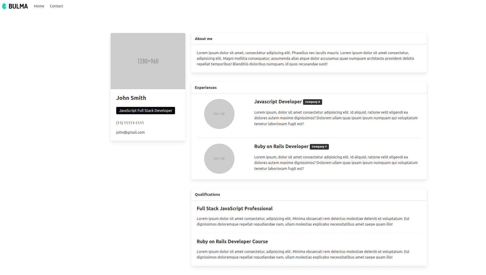
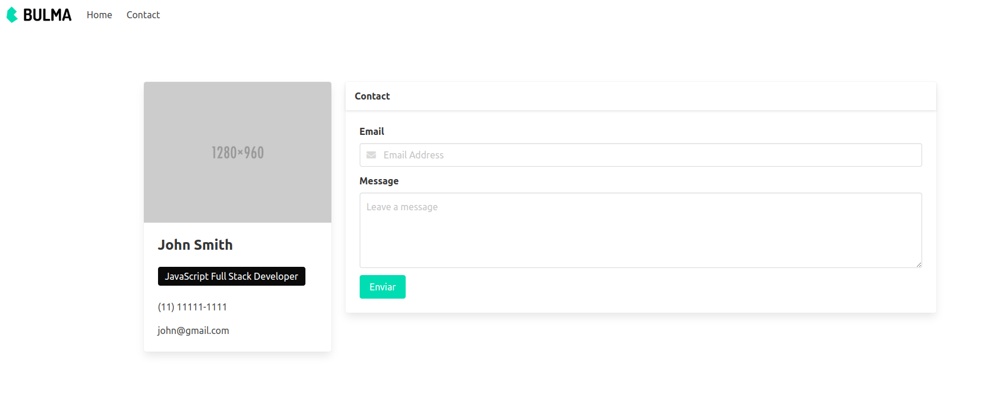

# Bulma Responsive Portfolio Template

Responsive portfolio template built with CSS framework Bulma.

### Technologies Used:

- HTML
- CSS
- Bulma

### To Run Locally

- Clone this repository with ```git clone https://github.com/Riccardo9190/bulma-responsive-portfolio.git```

- Access the app folder with ```cd bulma-responsive-portfolio```

- Run ```google-chrome home.html``` to open **Home page** 

- Run ```google-chrome contact.html``` to open **Contact page** 

<hr/>

## Project Images

### - Home page


<hr/>

### - Contact page

